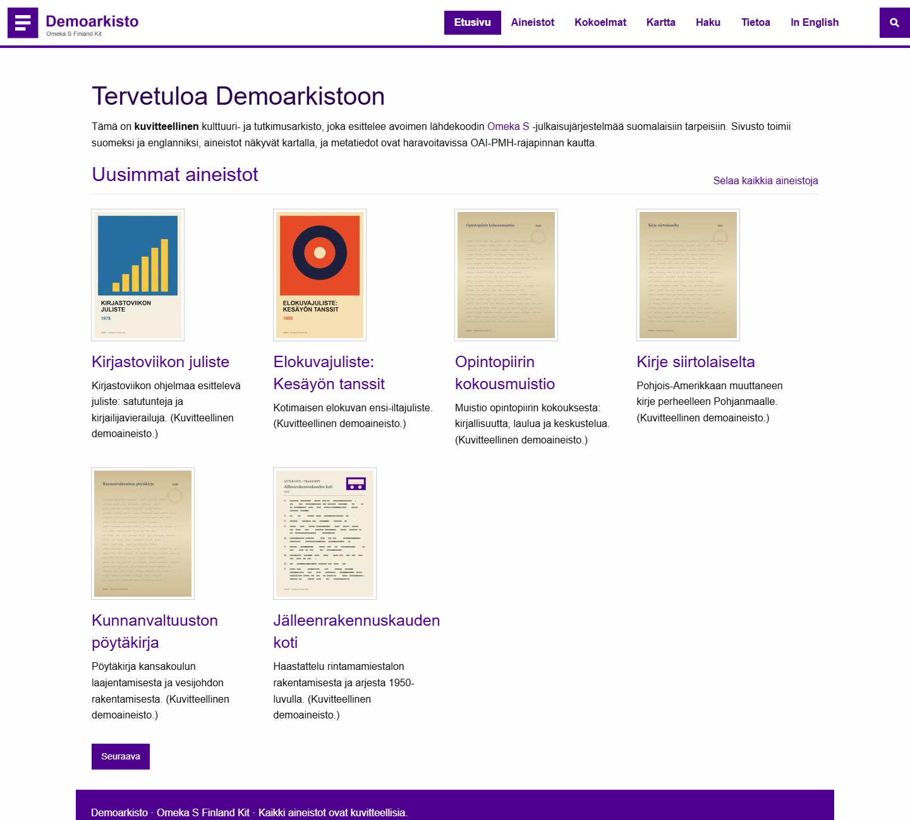
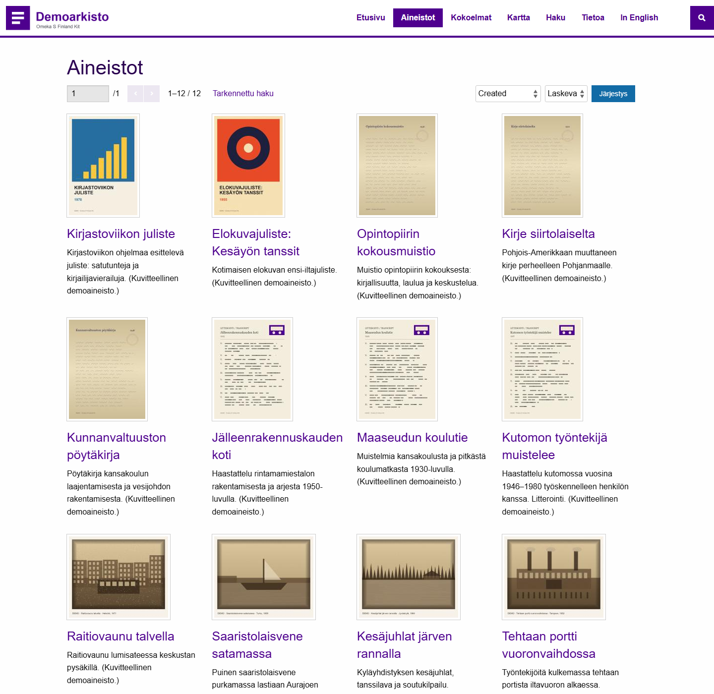
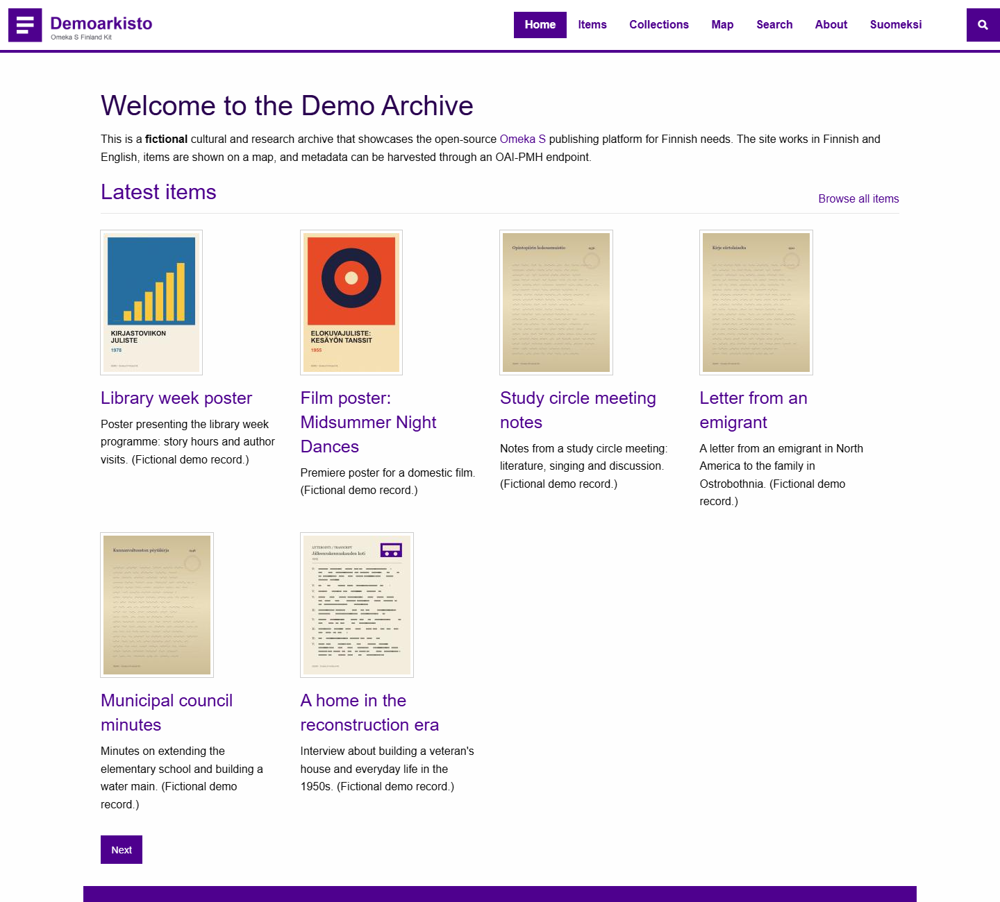
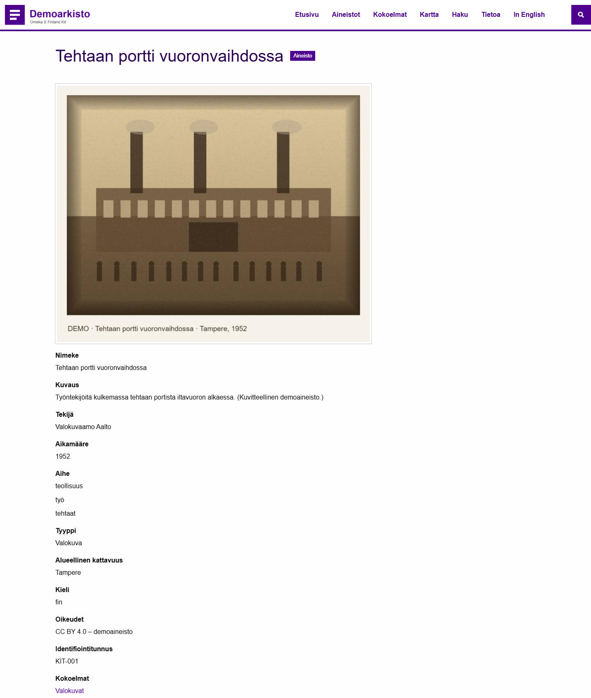
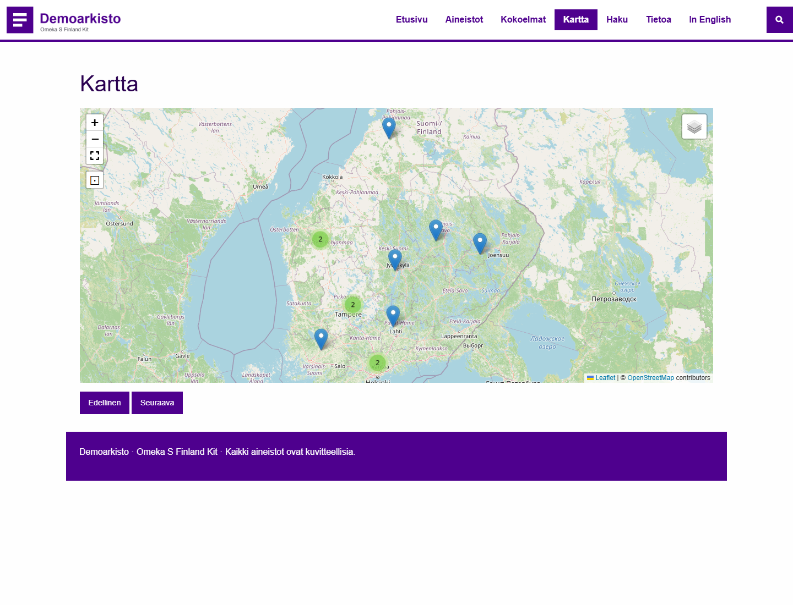
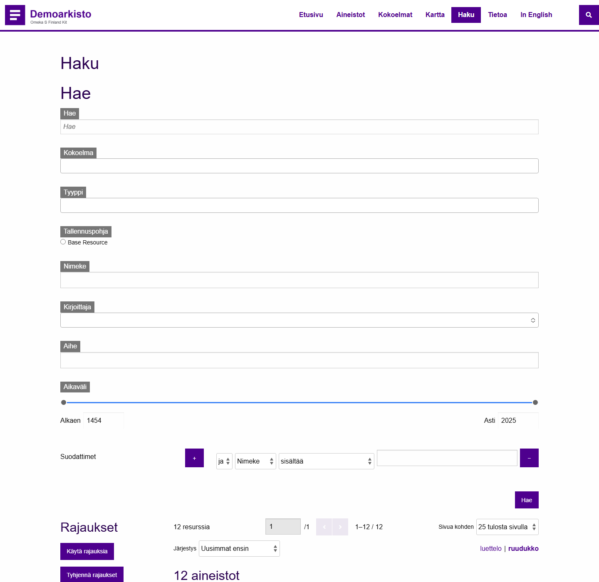
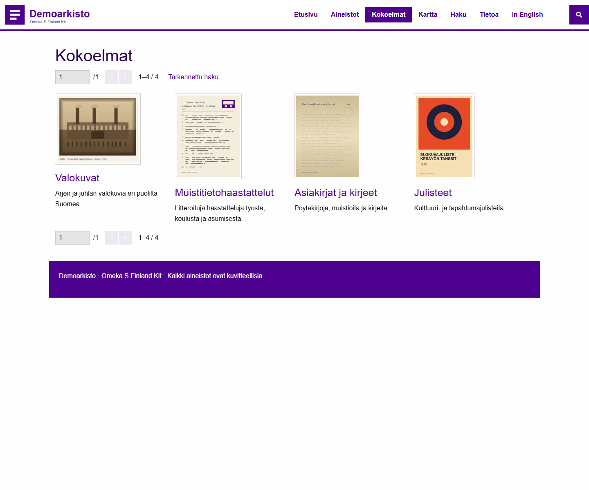
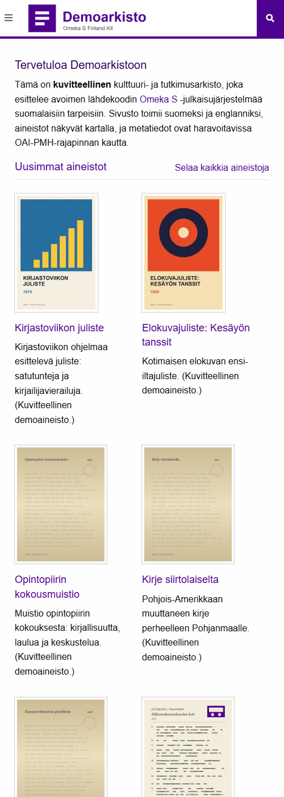

# Omeka S Finland Kit

**Suomenkielinen, kaksikielinen (fi/en) Omeka S -kokoonpano kulttuuri- ja tutkimusarkistoille.**
*A bilingual (Finnish/English) Omeka S distribution for cultural and research archives. [English summary below](#english).*

[](https://github.com/svenzer6/omeka-s-finland-kit/actions/workflows/ci.yml)




Kit kokoaa yhteen [Omeka S](https://omeka.org/s/) -julkaisujärjestelmän, 33 lisäosaa versioineen, lisäosien suomennokset, kaksikielisen demosivuston ja Docker-ympäristön. Yhdellä komennolla saat toimivan arkistopalvelun, jossa on:

- **Kaksikielisyys:** suomen- ja englanninkielinen sivusto (`/s/fi`, `/s/en`), jotka näyttävät samat aineistot kielitunnisteiden mukaan suodatettuina.
- **Suomennetut lisäosat:** julkisen käyttöliittymän tekstit 11 lisäosaan (noin 1 300 merkkijonoa).
- **Kartat:** aineistot kartalla (Mapping).
- **Tarkennettu haku** rajauksineen (Advanced Search), erilliset hakuasetukset kummallekin kielelle.
- **OAI-PMH-rajapinta** haravointia varten (OaiPmhRepository), arvot `xml:lang`-tunnisteilla.
- **Mukautettava ulkoasu:** Foundation-teema, oma logo, brändiväri ja fontti CSS Editorilla, eikä teematiedostoihin kosketa, joten päivitykset eivät riko mukautuksia.
- **Toistettava asennus:** kaikki lisäosat on lukittu tiettyyn versioon tiedostossa [`modules.json`](modules.json).

> **Huom.** Demoarkiston aineistot ja kuvat ovat **kuvitteellisia** ja skriptin generoimia. Suomennokset ovat **luonnos (v0.1)**, ja niiden kielentarkastus on kesken. Korjausehdotukset ovat tervetulleita.

## Kuvakaappaukset

| Suomeksi | In English |
|---|---|
|  |  |
|  |  |
|  |  |



## Pika-aloitus (Docker)

```bash
git clone https://github.com/svenzer6/omeka-s-finland-kit.git
cd omeka-s-finland-kit
cp .env.example .env        # vaihda kaikki CHANGE-ME-arvot
docker compose up -d --build
```

Avaa <http://localhost:8080/s/fi>. Ensimmäinen käynnistys asentaa Omeka S:n, aktivoi lisäosat ja luo demoarkiston (`KIT_DEMO=1`). Ylläpito: <http://localhost:8080/admin>, tunnukset tiedostosta `.env`.

| Muuttuja | Tarkoitus |
|---|---|
| `OMEKA_ADMIN_EMAIL`, `OMEKA_ADMIN_PASSWORD` | Ensimmäinen pääkäyttäjä. Jos tyhjä, käytä verkkoasennusta `/install`. |
| `KIT_DEMO` | `1` luo demoarkiston ensimmäisellä käynnistyksellä. |
| `KIT_HTTP_PORT` | Julkaistava portti (oletus 8080). |

Tuotantokäytössä aja palvelu käänteisen välityspalvelimen (esim. Caddy tai nginx + Let's Encrypt) takana ja varmuuskopioi tietokanta sekä `files`-taltio.

## Asennus ilman Dockeria

Vaatimukset: PHP 8.1+ (pdo_mysql, gd, intl, mbstring, fileinfo), MariaDB 10.6+ tai MySQL 8, Apache + mod_rewrite, Python 3.9+.

```bash
python scripts/fetch_modules.py /var/www/omeka-s --with-core   # Omeka S + lisäosat + teemat
# luo config/database.ini ja tietokanta, sitten:
OMEKA_ADMIN_EMAIL=admin@example.com OMEKA_ADMIN_PASSWORD='...' php scripts/install_omeka.php /var/www/omeka-s
php scripts/install_modules.php /var/www/omeka-s
python scripts/i18n.py install /var/www/omeka-s
php scripts/seed_demo.php /var/www/omeka-s        # valinnainen demo
```

**Windows (XAMPP):** ImageMagickia ei yleensä ole, ja Omekan taustatyöt käyttävät Unix-komentoja. Aseta tiedostoon `config/local.config.php`:

```php
'Omeka\File\Thumbnailer' => 'Omeka\File\Thumbnailer\Gd',
'Omeka\Job\DispatchStrategy' => 'Omeka\Job\DispatchStrategy\Synchronous',
```

## Skriptit

| Skripti | Kuvaus |
|---|---|
| `scripts/fetch_modules.py` | Lataa Omeka S:n, lisäosat ja teemat `modules.json`-tiedoston lukituilla versioilla (vain Pythonin vakiokirjasto). |
| `scripts/install_omeka.php` | Asentaa Omeka S:n ilman verkkolomaketta ympäristömuuttujien perusteella. |
| `scripts/install_modules.php` | Asentaa, päivittää ja aktivoi lisäosat riippuvuusjärjestyksessä (esim. Common ennen muita). |
| `scripts/i18n.py` | Suomennostyökalu: `todo` listaa puuttuvat julkiset merkkijonot, `build` kokoaa `.po`/`.mo`-tiedostot, `install` kopioi ne lisäosiin. |
| `scripts/public_strings.py` | Erottelee lisäosan julkisen käyttöliittymän merkkijonot ylläpidon merkkijonoista. |
| `scripts/seed_demo.php` | Luo kaksikielisen demoarkiston: sivustot, kokoelmat, 12 aineistoa, karttapisteet, haun ja sivut. `--reset` luo uudelleen. |
| `scripts/screenshots.py` | Ottaa README-kuvakaappaukset headless Chromella. |

## Lisäosat

| Lisäosa | Versio | Lähde | Rooli |
|---|---|---|---|
| Access | 3.4.47 | [Daniel-KM/Omeka-S-module-Access](https://github.com/Daniel-KM/Omeka-S-module-Access) | asennus |
| ActivityLog | v1.0.1 | [omeka-s-modules/ActivityLog](https://github.com/omeka-s-modules/ActivityLog) | asennus |
| AdvancedResourceTemplate | 3.4.55 | [Daniel-KM/Omeka-S-module-AdvancedResourceTemplate](https://github.com/Daniel-KM/Omeka-S-module-AdvancedResourceTemplate) | asennus |
| Analytics | 3.4.15 | [Daniel-KM/Omeka-S-module-Analytics](https://github.com/Daniel-KM/Omeka-S-module-Analytics) | asennus |
| Banner | v1.0 | [rochester-rcl/Omeka-S-Banner](https://github.com/rochester-rcl/Omeka-S-Banner) | asennus |
| BlocksDisposition | 3.4.6 | [Daniel-KM/Omeka-S-module-BlocksDisposition](https://github.com/Daniel-KM/Omeka-S-module-BlocksDisposition) | asennus |
| BulkEdit | 3.4.40 | [Daniel-KM/Omeka-S-module-BulkEdit](https://github.com/Daniel-KM/Omeka-S-module-BulkEdit) | asennus |
| BulkImport | 3.4.65 | [Daniel-KM/Omeka-S-module-BulkImport](https://github.com/Daniel-KM/Omeka-S-module-BulkImport) | asennus |
| Coins | v3.1.0 | [biblibre/omeka-s-module-Coins](https://github.com/biblibre/omeka-s-module-Coins) | asennus |
| Common | 3.4.93 | [Daniel-KM/Omeka-S-module-Common](https://github.com/Daniel-KM/Omeka-S-module-Common) | asennus |
| CSSEditor | v1.3.1 | [omeka-s-modules/CSSEditor](https://github.com/omeka-s-modules/CSSEditor) | asennus |
| CSVImport | v2.6.2 | [omeka-s-modules/CSVImport](https://github.com/omeka-s-modules/CSVImport) | asennus |
| CustomVocab | v2.1.0 | [omeka-s-modules/CustomVocab](https://github.com/omeka-s-modules/CustomVocab) | asennus |
| DynamicItemSets | 3.4.7 | [Daniel-KM/Omeka-S-module-DynamicItemSets](https://github.com/Daniel-KM/Omeka-S-module-DynamicItemSets) | asennus |
| EasyAdmin | 3.4.49 | [Daniel-KM/Omeka-S-module-EasyAdmin](https://github.com/Daniel-KM/Omeka-S-module-EasyAdmin) | asennus |
| FileSideload | v1.7.1 | [omeka-s-modules/FileSideload](https://github.com/omeka-s-modules/FileSideload) | asennus |
| LocaleSwitch | v0.3.0 | [biblibre/omeka-s-module-LocaleSwitch](https://github.com/biblibre/omeka-s-module-LocaleSwitch) | asennus |
| Log | 3.4.41 | [Daniel-KM/Omeka-S-module-Log](https://github.com/Daniel-KM/Omeka-S-module-Log) | asennus |
| OaiPmhRepository | 3.4.14 | [Daniel-KM/Omeka-S-module-OaiPmhRepository](https://github.com/Daniel-KM/Omeka-S-module-OaiPmhRepository) | asennus |
| PersistentIdentifiers | v1.2.0 | [omeka-s-modules/PersistentIdentifiers](https://github.com/omeka-s-modules/PersistentIdentifiers) | asennus |
| ValueSuggest | v1.21.0 | [omeka-s-modules/ValueSuggest](https://github.com/omeka-s-modules/ValueSuggest) | asennus |
| AdvancedSearch | 3.4.65 | [Daniel-KM/Omeka-S-module-AdvancedSearch](https://github.com/Daniel-KM/Omeka-S-module-AdvancedSearch) | asennus + suomennos |
| BlockPlus | 3.4.45 | [Daniel-KM/Omeka-S-module-BlockPlus](https://github.com/Daniel-KM/Omeka-S-module-BlockPlus) | asennus + suomennos |
| BotChallenge | 3.4.5 | [Daniel-KM/Omeka-S-module-BotChallenge](https://github.com/Daniel-KM/Omeka-S-module-BotChallenge) | asennus + suomennos |
| ContactUs | 3.4.32 | [Daniel-KM/Omeka-S-module-ContactUs](https://github.com/Daniel-KM/Omeka-S-module-ContactUs) | asennus + suomennos |
| Group | 3.4.8 | [Daniel-KM/Omeka-S-module-Group](https://github.com/Daniel-KM/Omeka-S-module-Group) | asennus + suomennos |
| Guest | 3.4.44 | [Daniel-KM/Omeka-S-module-Guest](https://github.com/Daniel-KM/Omeka-S-module-Guest) | asennus + suomennos |
| GuestPrivate | 3.4.8 | [Daniel-KM/Omeka-S-module-GuestPrivate](https://github.com/Daniel-KM/Omeka-S-module-GuestPrivate) | asennus + suomennos |
| Hierarchy | v1.2.2 | [omeka-s-modules/Hierarchy](https://github.com/omeka-s-modules/Hierarchy) | asennus + suomennos |
| Mapping | v2.3.0 | [omeka-s-modules/Mapping](https://github.com/omeka-s-modules/Mapping) | asennus + suomennos |
| MetadataBrowse | v1.6.1 | [omeka-s-modules/MetadataBrowse](https://github.com/omeka-s-modules/MetadataBrowse) | asennus + suomennos |
| Reference | 3.4.64 | [Daniel-KM/Omeka-S-module-Reference](https://github.com/Daniel-KM/Omeka-S-module-Reference) | asennus + suomennos |
| Mapper | 3.4.8 | [Daniel-KM/Omeka-S-module-Mapper](https://github.com/Daniel-KM/Omeka-S-module-Mapper) | riippuvuus (BulkImport) |

Teemat: [Foundation](https://github.com/omeka-s-themes/foundation-s) 1.5.4 (demon oletus) ja [Thanks, Roy](https://github.com/omeka-s-themes/thanksroy) 1.2.2.

### Lisäosan päivittäminen

1. Päivitä versio ja lataus-URL tiedostoon `modules.json`.
2. `python scripts/fetch_modules.py <omeka> --only <Nimi> --force`
3. `php scripts/install_modules.php <omeka>` (ajaa Omekan päivitysrutiinin)
4. `python scripts/i18n.py todo <omeka>` näyttää uudet suomennettavat merkkijonot.

## Suomennokset

Käännökset ovat tiedostoissa `translations/<Lisäosa>.fi_FI.json` (lähdeteksti → suomennos), ja niistä kootut gettext-tiedostot hakemistoissa `translations/<Lisäosa>/fi_FI.po|.mo`. Lisäosan oma suomennos on pohjana, ja kitin käännös korvaa sen.

| Lisäosa | Julkiset merkkijonot | Käännetty |
|---|---:|---:|
| AdvancedSearch | 430 | 424 |
| BlockPlus | 309 | 309 |
| BotChallenge | 37 | 29 |
| ContactUs | 175 | 175 |
| Group | 23 | 23 |
| Guest | 286 | 283 |
| GuestPrivate | 17 | 16 |
| Hierarchy | 31 | 31 |
| Mapping | 187 | 185 |
| MetadataBrowse | 13 | 13 |
| Reference | 78 | 77 |

Kääntämättä jätetyt ovat tuotenimiä (esim. Googlebot) tai teknisiä tunnisteita. Tavoitteena on tarjota käännökset myös lisäosien alkuperäisille kehittäjille.

## Tiekartta

- [ ] Suomennosten kielentarkastus
- [ ] Finnan `qdc`-haravointiformaatti OAI-PMH-rajapintaan
- [ ] Finto/YSO-asiasanaston tuki Value Suggest -lisäosaan
- [ ] Käännösten lähettäminen lisäosien alkuperäisille projekteille
- [ ] Varmuuskopiointi- ja palautusohje (tietokanta + `files`)

## Lisenssi

Kitin skriptit ja asetukset: [GPL-3.0-or-later](LICENSE). Omeka S ja lisäosat noudattavat omia lisenssejään (GPL-3.0 tai CeCILL 2.1). Kunkin lisäosan suomennos jaetaan saman lisenssin ehdoin kuin kyseinen lisäosa. Demoaineisto (`demo/`, generoidut kuvat): CC BY 4.0.

Omeka on Corporation for Digital Scholarshipin tavaramerkki. Tämä projekti ei ole Omeka-tiimin virallinen julkaisu.

---

<a id="english"></a>
## English

**Omeka S Finland Kit** packages [Omeka S](https://omeka.org/s/) 4.2.1 with 33 pinned modules, Finnish translations for the public interface of 11 modules (about 1,300 strings), a bilingual demo archive and a Docker setup.

- Two sites, `/s/fi` and `/s/en`, share the same items. Values are language-tagged (`fi-FI`, `en-US`) and filtered by the site locale.
- Map (Mapping), faceted search with one search config per language (Advanced Search), OAI-PMH endpoint (OaiPmhRepository).
- Branding through CSS Editor (logo, colour, font) without modifying theme files, so theme updates stay safe.
- Every module version is pinned in [`modules.json`](modules.json). `install_modules.php` installs modules in dependency order and restarts itself so that services of new modules (e.g. Common) are loaded before their dependants are installed.

Quick start: `cp .env.example .env`, edit the secrets, `docker compose up -d --build`, then open <http://localhost:8080/s/en>. The demo content is fictional and generated. The Finnish translations are a draft pending language review.
